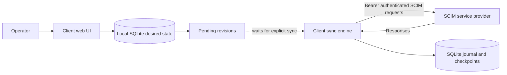
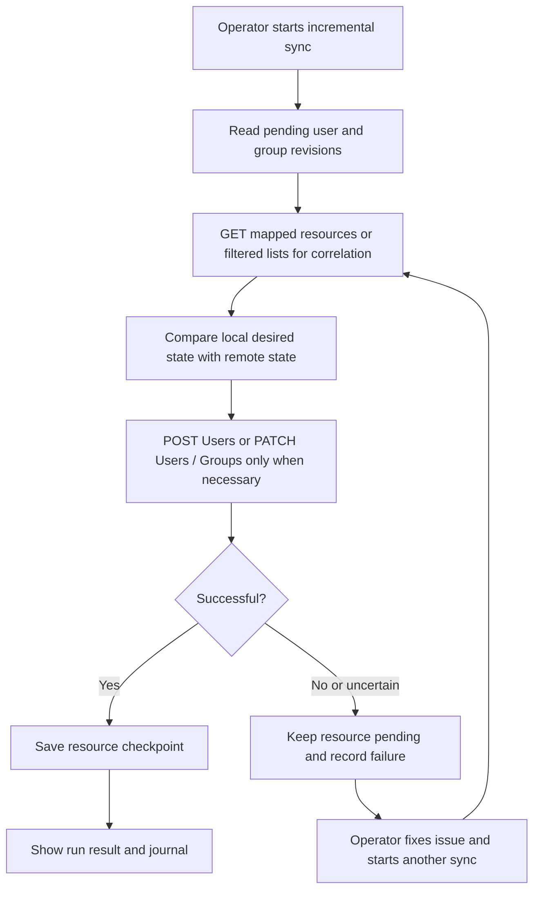
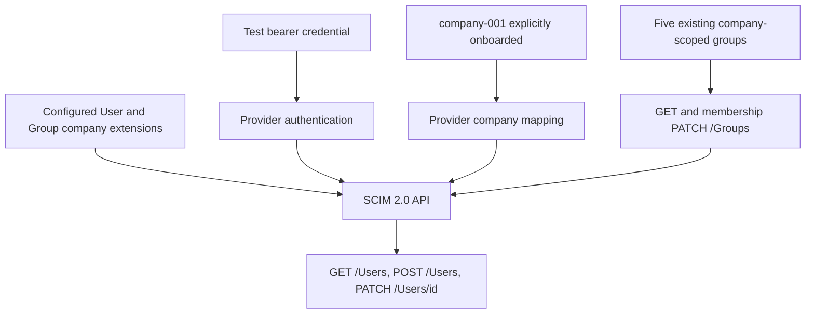

# SCIM Client Lab

A local, interactive **SCIM 2.0 client** for exercising a separately implemented **SCIM service provider**. Edit users and group assignments in a web UI, then explicitly provision those changes. Inspect every outbound HTTP request and response in a persistent journal.

The client is not a SCIM service provider. It does not expose `/Users` or `/Groups` APIs for other clients. See [the glossary](docs/GLOSSARY.md) for terminology.

## Install

Install [uv](https://docs.astral.sh/uv/getting-started/installation/), clone this repository, and run from its root:

```sh
uv python install 3.14
uv sync --locked
```

Python 3.14 is pinned because the Python 3.15 build available through uv during implementation was a release candidate, not a final release. No prerelease runtime is required. Dependencies are pinned in `uv.lock`; Ruff and pytest are local development dependencies.

## Run

```sh
uv run scim_client
```

Open **http://127.0.0.1:5000**. First startup creates and seeds the database. You can explore and edit local data before a service provider exists. Sync needs a running provider.

The server is a local development server: run **one process**, bound to localhost, with no debug/reloader mode. Sync runs synchronously; UI requests and edits wait until it finishes. There is no scheduler or background sync. Stop with Ctrl+C. After an interrupted run, run a full sync to reconcile uncertain remote outcomes.

## Configure

In **Connection**, save:

- **Base URL**, including the SCIM path prefix, for example `http://127.0.0.1:8000/scim/v2`.
- **Bearer token**, sent as `Authorization: Bearer <token>`. A blank token field retains the stored token.
- **User company extension URN** and **Group company extension URN**. Both extensions use an immutable string attribute named `companyId`.

Default extension URNs:

```text
urn:example:scim:schemas:extension:company:2.0:User
urn:example:scim:schemas:extension:company:2.0:Group
```

Changing the base URL or either extension URN clears cached provider IDs and checkpoints, marking all resources pending. Changing only the token retains mappings; use full sync after changing the token's scope. Configuration changes never make network requests.

Only one connection is stored. Multiple companies can share it; the initial company is `company-001`, named Roshar Industries. Add companies in the UI. Company IDs on existing users cannot be changed.

### Security boundary

This is a trusted, local test tool, not a production administration portal:

- No login. Bind only to localhost; do not expose it through a public proxy or tunnel.
- Forms use CSRF protection; host validation and browser security headers are enabled.
- The bearer token is stored **in plaintext** in SQLite, not rendered back into HTML, and redacted from the journal. Protect database files and backups.
- Database files use mode `0600`; newly created data directories use `0700`.
- The journal retains identity data and response bodies. Use synthetic identities and test credentials only.
- HTTPS certificate verification remains enabled. HTTP is allowed for local providers. Redirects and environment proxy configuration are not followed, avoiding credential forwarding.

## Where data lives

Default: **`data/client.sqlite3`**, relative to the repository, regardless of the shell's working directory. Override with an absolute path:

```sh
SCIM_DB=/absolute/path/client.sqlite3 uv run scim_client
```

SQLite stores companies, users, provider-owned group references, memberships, connection settings, provider ID mappings, revision checkpoints, sync runs, and the HTTP journal. Local database files are ignored by Git. No external database or frontend build tooling is required.

- `sql/schema.sql`: database structure and cross-company membership constraint.
- `sql/seed.sql`: separate, repeatable destructive reset and seed script.
- `scim_client/db.py`: database initialization.
- `scim_client/sync.py`: protocol, correlation, pagination, checkpoints, reconciliation.
- `scim_client/web.py` and `templates/`: local UI.
- `tests/test_sync.py`: core behavior demonstrated with an in-memory HTTP transport.

Seeded users: Kaladin Stormblessed, Shallan Davar, Dalinar Kholin, Jasnah Kholin, Adolin Kholin, Navani Kholin, and disabled Szeth Son-son-Vallano. All email addresses use the reserved `.example` domain.

Seeded group references: **All Employees**, **Engineering**, **Human Resources**, **Finance**, and **IT Administrators**.

### Reset

Stop the server first. This clears **all local data**, including credentials and journal history, then reapplies `sql/seed.sql`:

```sh
uv run scim_client reset --yes
```

To initialize without starting the server:

```sh
uv run scim_client init
```

Alternatively, after initialization, run the SQL script directly:

```sh
sqlite3 data/client.sqlite3 < sql/seed.sql
```

Reset does **not** undo provisioning on the service provider. Seeded external IDs are stable so existing seeded users can be correlated again. Locally created users have random stable UUID external IDs; after reset their former remote accounts become remote-only and are left untouched. Never reset while a sync is running.

## Supported behavior

| Area | Behavior |
| --- | --- |
| Users | List, create, edit username/name/work email, disable, reactivate |
| Lifecycle | `POST /Users` and `PATCH /Users/{id}`; removal is deactivation, not physical deletion |
| Groups | List existing catalog references and assign/unassign users |
| Membership | `PATCH /Groups/{id}` with `add members` and filtered `remove members[value eq "..."]` |
| Companies | One seeded company; multiple local companies, immutable IDs, company-scoped correlation |
| Full sync | Read paginated remote users/groups, then reconcile every local user/group |
| Incremental sync | Process pending local revisions, read affected remote resources, then provision differences |
| Recovery | Checkpoint each successfully reconciled resource; failed resources remain pending |
| Observation | Pending local work list, run results, redacted request/response journal with timing and attempts |
| Transport | Bearer authentication, JSON SCIM media type, 20-second HTTP timeout, bounded GET retries |

Not implemented: aggregation/import into local desired state, group creation/rename/deletion, physical user deletion, password management, OAuth token acquisition, nested groups, bulk requests, PUT, automatic scheduling, ETag/`If-Match` concurrency control, delta aggregation, discovery endpoint calls, or per-company credentials. The client has explicit schema configuration instead of automatic schema discovery.

Group definitions are provider-owned. To add a catalog reference for another company, stop the client and insert a row in the local `groups` table using SQLite, then provision the actual group independently on the service provider. There is deliberately no group creation UI or outbound group creation request:

```sql
INSERT INTO groups(id, company_id, display_name)
VALUES ('company-002-engineering', 'company-002', 'Engineering');
```

Add `company-002` through the UI first. Never edit cached provider IDs or revision checkpoints manually.

### Correlation and ownership

- User `externalId` is the immutable local user ID. Initial correlation requires exact `externalId` and company ID. There is no username/email fallback.
- Group initial correlation requires exact `displayName` and company ID. Missing or ambiguous groups fail visibly; they are never created.
- Once correlated, the provider's opaque `id` is cached and used for subsequent requests. Every mapped resource is checked for the expected company before modification.
- A previously mapped resource that disappears is reported as an error rather than silently recreated or rebound. Resolve the provider-side problem before retrying.
- Local managed user fields are authoritative. Full sync repairs remote drift in those fields. Incremental sync does not discover drift in unchanged resources.
- Remote-only users, groups, and group members with no local managed user mapping are left untouched. A remote user with a matching external ID and company is correlated and becomes managed, not remote-only.
- For a managed group, the client owns membership of managed users. It removes managed memberships absent from local desired state, but preserves memberships belonging to remote-only users.
- Disabled users retain local assignments. Sync removes their managed memberships; reactivation restores them. User provisioning must succeed before dependent assignments are reconciled.

### Checkpoints, failures, and retries

Local edits increment a revision; successful reconciliation stores that revision as the checkpoint. A group membership change marks the group pending. When any users are processed, all local group memberships are revisited to account for new IDs and lifecycle changes. A clean incremental sync sends no HTTP requests.

HTTP GET requests retry up to three total attempts for transport failures and statuses `429`, `502`, `503`, and `504`. Numeric `Retry-After` values up to 30 seconds are honored; longer values or HTTP dates defer retry to a later manually initiated run. Without that header, delays are one then two seconds. Other failures are immediately visible.

Mutating requests are **not blindly retried**. A timeout may mean the service provider applied the request but the response was lost. On the next manual sync, the client reads remote state first: it correlates uncertain creates by external ID and computes membership differences again. Uniqueness enforcement on the provider remains necessary. Partial success is retained, not rolled back across resources. A malformed or rejected response leaves work pending. After process termination, prior running runs are marked interrupted at startup; use full sync for recovery.

## Flows

### Local edits do not synchronize



### Full sync

```mermaid
sequenceDiagram
    actor Operator
    participant C as SCIM client
    participant DB as Local SQLite
    participant SP as SCIM service provider
    Operator->>C: Full sync
    C->>SP: GET /Users?startIndex=1&count=100
    SP-->>C: Paginated ListResponse
    C->>SP: GET /Groups?startIndex=1&count=100
    SP-->>C: Paginated ListResponse
    Note over C,SP: Continue pagination until totalResults is reached
    C->>DB: Read all local desired state
    loop Each local user
        C->>SP: POST missing User or PATCH changed managed fields
        SP-->>C: Resource with ID or successful PATCH
        C->>DB: Save mapping and checkpoint on success
    end
    loop Each local provider-owned group reference
        Note over C,SP: Resolve existing group; never POST /Groups
        C->>SP: PATCH membership differences, if any
        C->>DB: Save checkpoint on success
    end
    C-->>Operator: Run result and HTTP journal
```

### Incremental sync and recovery



### Service provider prerequisites



Before the first sync, the service provider must have:

1. A reachable SCIM base URL and accepted bearer token with user read/write and group read/membership-write permissions.
2. An explicitly onboarded `company-001` and the configured custom company extensions on both User and Group resources. The client does not create provider tenants.
3. The five seeded groups, with exactly the display names listed above, each carrying `companyId: "company-001"`. Provider IDs can be any stable opaque strings.
4. Paginated `GET /Users` and `GET /Groups`, returning SCIM `ListResponse` with `schemas`, `totalResults`, `Resources`, and 1-based `startIndex`. Full group membership values must be returned; truncated member arrays are unsupported.
5. Equality filters on `externalId` for users and `displayName` for groups, for example `GET /Users?filter=externalId eq "user-kaladin"` (URL-encoded on the wire).
6. `GET /Users/{id}` and `GET /Groups/{id}`; user creation returning a resource body with a nonempty stable string `id`; PATCH accepting the SCIM PatchOp schema and returning success, typically 200 or 204.
7. Company isolation enforcement, external-ID uniqueness, and correct error responses. Do not trust this client to provide the service provider's security boundary.

A pre-existing provider group would look like:

```json
{
  "schemas": [
    "urn:ietf:params:scim:schemas:core:2.0:Group",
    "urn:example:scim:schemas:extension:company:2.0:Group"
  ],
  "id": "provider-group-42",
  "displayName": "Engineering",
  "members": [],
  "urn:example:scim:schemas:extension:company:2.0:Group": {
    "companyId": "company-001"
  }
}
```

The client will create users with the core User schema, the configured company extension, `externalId`, `userName`, structured `name`, one primary work `emails` entry, and `active`. It updates memberships on Groups, never through the User `groups` attribute.

## Development checks

```sh
uv run ruff check .
uv run ruff format --check .
uv run pytest -q
uv audit --locked
```

Tests cover idempotent reconciliation and pagination, failed checkpoints and redaction, uncertain-create recovery, disable/reactivate membership behavior, missing provider groups, company mismatch rejection, and explicit-only UI provisioning.

Protocol references: [RFC 7643: core schema](https://www.rfc-editor.org/rfc/rfc7643) and [RFC 7644: protocol](https://www.rfc-editor.org/rfc/rfc7644).
